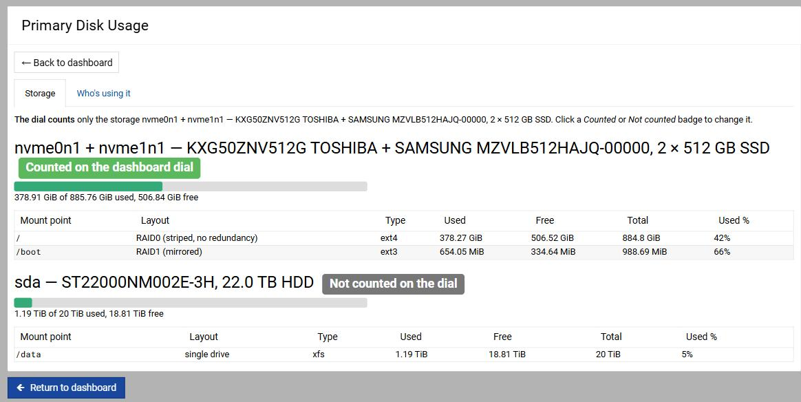
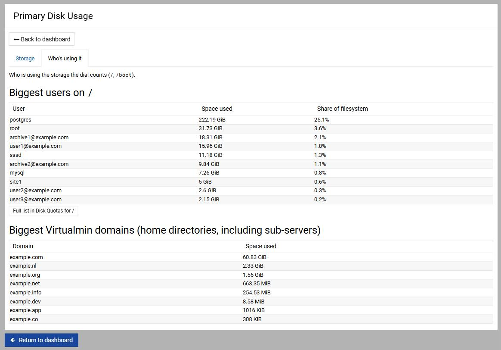
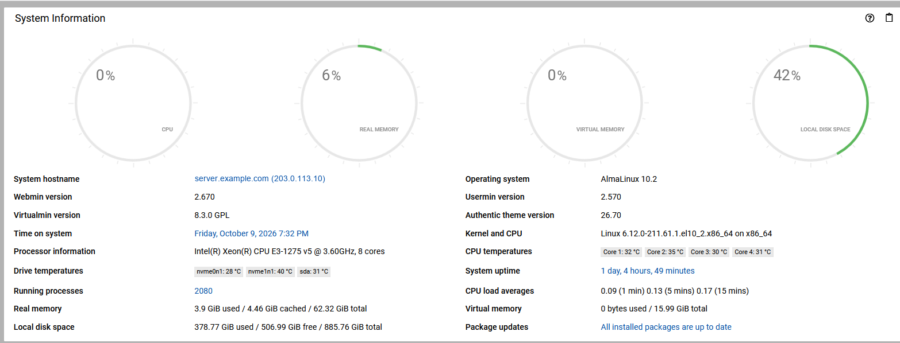

# Webmin disk overview (Primary Disk Usage)

A small Webmin module that answers the question the Dashboard's disk dial
raises: *which disks, how full, and who is using them?* Stock Webmin sends
that click to a per-user quota table for `/` only.

Written for one production server (two 512 GB NVMe SSDs in RAID plus a 22 TB
HDD) running Webmin 2.670 and Virtualmin 8.3 on AlmaLinux 10. Shared so the
Webmin maintainers can see it in full; see "Status" below.

The Dashboard dial counting only the SSD pair (885.76 GiB) instead of
adding the 20 TiB HDD to it:

User names, domains and the host name in these screenshots are replaced
with example values; the figures are real.

## What it does

**Storage tab.** Drives that are used together (an mdraid or LVM set) are one
entry, because half of a striped pair is not a meaningful unit. Each entry is
labelled with the drive models, sizes and SSD or HDD (from
`/sys/block/*/queue/rotational`), and lists the filesystems on it with their
RAID level ("RAID1 (mirrored)", "RAID0 (striped, no redundancy)"), type and
usage. Bind mounts of the same device are not listed twice. Used space is
total minus free, as the Dashboard dial counts it, so ext4's blocks reserved
for root count as used and the page and the dial show the same percentage.
Each storage entry carries a *Counted* / *Not counted* badge showing whether
the Dashboard dial includes it, and the badge links to the setting that
decides it. If that setting names nothing that is mounted, the dial falls
back to counting everything, and the page says so.

**Who's using it tab.** The ten largest users on each counted filesystem
that has quotas, with a link to the full Disk Quotas list, and, when
Virtualmin is installed, the ten largest virtual servers (home directories
including sub-servers). Filesystems without quotas are left out.

**Dashboard panel.** A System Information panel showing usage for the
counted filesystems only (`system_info.pl`).

**Dial routing.** Authentic Theme sends the disk dial to `/disk-usage` when a
module of that name exists. `disk-usage/` is a hidden module that redirects
to this page, so no theme change is needed.

## Layout

| path | what |
|---|---|
| `disk-focus/` | the module: `index.cgi` (the tabs), `collect-fs-lib.pl` (drive grouping, SSD or HDD, RAID levels, the counted-or-not setting), `disk-focus-lib.pl` (what the dial counts, panel figures), `system_info.pl` (Dashboard panel) |
| `disk-usage/` | hidden redirect module that claims the dial's `/disk-usage` slot |
| `stopgap-hooks/` | the installer for the three hooks that made the dial count only chosen disks before Webmin had a setting for it; see below |
| `tests/` | checks run on our server against the live install (see below) |

## Tests

They run on the server itself and read its real drives, quotas and
Virtualmin domains, so some expectations (an NVMe pair plus one HDD) are
specific to our machine. Each compares the page with an independent source
rather than with itself:

| test | checks |
|---|---|
| `test-disk-page-render.pl` | renders the page; every figure equals Webmin's own disk data, the quota figures equal `repquota`, the domain figures equal `virtualmin list-domains` |
| `test-dial-agreement.pl` | for seven settings, including ones that match nothing, what the page marks *Counted* totals exactly what the dial code counts |
| `test-panel-numbers.pl` | the Dashboard panel uses the same used/free rule as the dial |
| `test-collect-fs.pl` | drive grouping, RAID labels, bind mounts, the settings form and the cache reset on save |
| `test-dial-route.pl` | the `disk-usage` redirect and the return link after saving |

`DF_PAGE`, `DF_DIR` and `DF_LIB` point a test at another copy of the code,
which is how each check was shown to fail on the code it guards against.

## Status, and the stopgap hooks

Until now Webmin had no way to leave a filesystem out of the Dashboard disk
total, so a 22 TB bulk volume swamped the SSDs in one figure. To fix that on
our server, `stopgap-hooks/` revived Virtualmin's long-dead `collect_fs`
setting ("Filesystems to include in local disk space") with three small
hooks into `virtual-server` and `system-status`, plus a chooser that picks
whole drive groups. Patching distribution files is not something we would
propose upstream; it is here only so the full picture is visible.

[webmin/webmin#2870](https://github.com/webmin/webmin/pull/2870) now adds
the proper setting (Dashboard exclusions in the Disk and Network
Filesystems module configuration). Once it is released, the hooks go away
and this module reads its *Counted* badges from that setting instead. If the
maintainers want the page in Webmin, that is the version that would be
submitted, named `disk-usage` itself rather than redirecting.

## Licence

BSD 3-Clause, the same as Webmin. See `LICENSE`.
